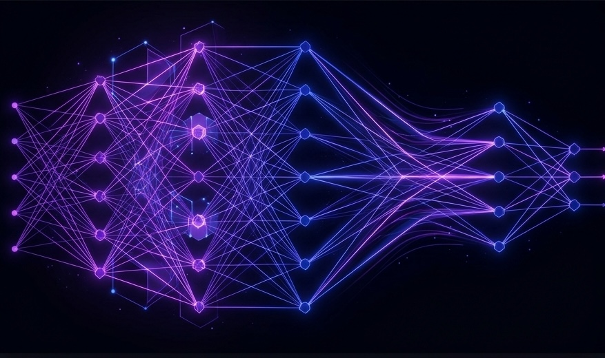

  

<h1 align="center">Meisam Mahmoodi 🧠</h1>

  

  INTERPRETABILITY • SPARSE CONCEPT LEARNING • CAUSAL REPRESENTATION LEARNING

  
  
  

---

### 🧐 About Me

I am a **Computer Science PhD candidate** at **Adelaide University**, Australia, in the **Causal AI Group** (AIML), supervised by **Prof. Javen Qinfeng Shi**.

I study what language models represent inside their activations. My main question is simple: when the same meaning is written in different ways — a paraphrase, a simpler rewrite, another language — which part of the model's representation stays the same (**content**), and which part changes (**form / realization**)? I build sparse, concept-level methods (SAEs and **Concept Component Analysis, ConCA**) that separate these two parts and test them with causal interventions, not only with probes.

---

### 🚀 Current Project: [Multi-View ConCA](https://github.com/MeiisamMahmoodii/MVConCA)

**The problem.** Sparse autoencoders (SAEs) find features that *detect* things in a model's activations, but pushing one of those features often doesn't *control* the model cleanly. Ask for "blue" and the shape or material changes too, or nothing changes at all. One reason: an SAE rebuilds each activation on its own, so nothing tells it to keep **what is said** (the facts) apart from **how it is said** (the wording).

**What Multi-View ConCA does.** It extends Concept Component Analysis (ConCA) by splitting the learned code into two blocks:

*   **C — content**: the facts.
*   **S — style**: the wording.

It learns this split from two kinds of paired examples:

| Pair type | Example | What the training does |
|---|---|---|
| **Paraphrase** — same facts, new wording | "a small red metal cube" ↔ `{"object": "cube", "colour": "red", …}` | pull the two **C** codes together |
| **Minimal edit** — one fact changes, same wording | "a small **red** metal cube" ↔ "a small **blue** metal cube" | keep **S** fixed, so only **C** moves |

**The result.** Push a *single* content coordinate and the model's answer changes only the fact you targeted:

> "small red metal cube" → push the colour coordinate → "small **blue** metal cube" ✓ (shape, size and material unchanged)

On scenes and wording styles never seen in training, one-coordinate edits change the target answer while keeping all the other answers correct in **64.4%** of cases. The best SAE baseline gets **31.5%**, so this is about twice as good. The edits also steer free-form generation and work on models from different families. *Paper in preparation.*

---

### 📚 Earlier Work

*   **SetConCA** — set-conditioned sparse concept learning: extends pointwise SAEs by learning concept codes from *sets* of related views (paraphrases, multiple captioning models) instead of single sentences.
*   **Utilizing Large Language Models for DDoS Attack Detection** (2024) — *M. Mahmoodi*, OPJU International Technology Conference (OTCON). Turns network traffic features into natural-language descriptions so LLMs can detect DDoS attacks with zero-shot reasoning and parameter-efficient fine-tuning.

📄 Full list on [Google Scholar](https://scholar.google.com/citations?hl=en&user=IOXPIqEAAAAJ).

---

### 🛠️ Languages & Tools

  
   
  

---

### 📊 GitHub Analytics

  
  

